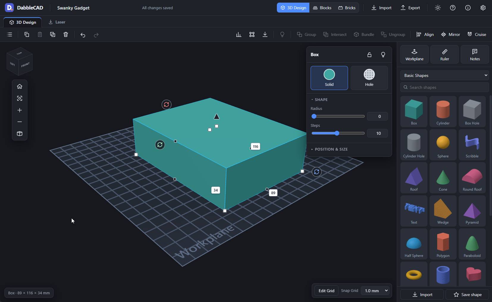
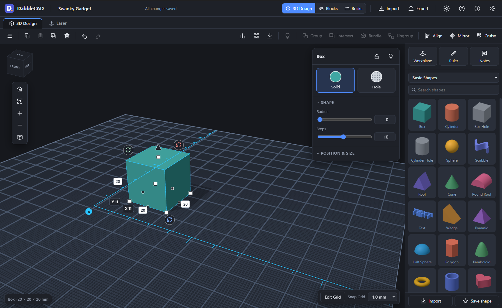
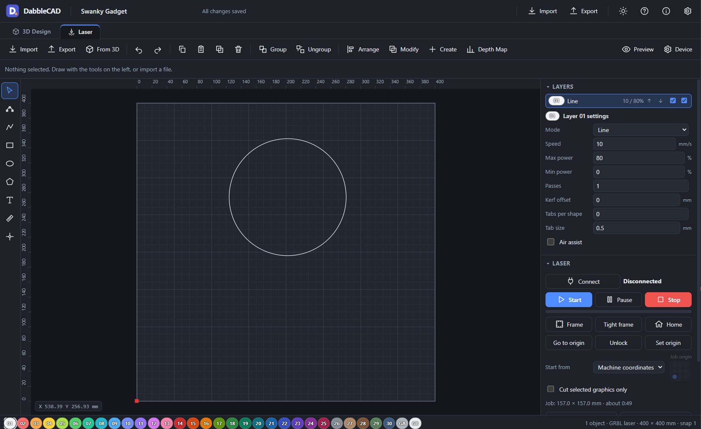
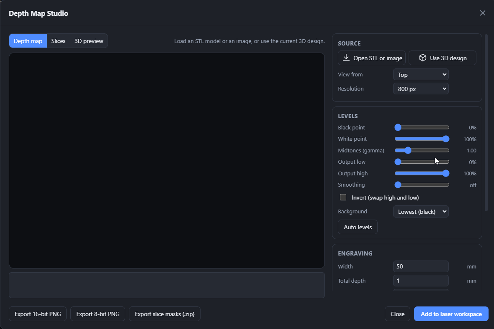

<p align="center">
  <picture>
    <source media="(prefers-color-scheme: dark)" srcset="docs/logo-dark.png">
    
  </picture>
</p>

# DabbleCAD

**One offline, open-source app for 3D design, laser projects, and depth maps.**

DabbleCAD puts four maker tools in a single desktop app, saved together in one design:

- **3D Design:** shape-based modeling inspired by Tinkercad. Drag shapes onto a
  workplane, stretch and rotate them, turn some into holes, group them into one part,
  and export an STL or 3MF for your slicer.
- **Laser:** draw or import artwork, set up layers, preview the job, and export
  G-code or send it to a GRBL-compatible laser over USB.
- **CNC:** draw or import artwork, pick what to cut out, pocket, V-carve, or drill,
  watch a 3D preview carve it, then save G-code or run a GRBL-compatible router.
- **Depth Map Studio:** turn a 3D model or an image into a height map for relief
  engraving.

Model a part, bring its outline into the laser workspace, or turn it into a relief,
without exporting and re-importing between apps. DabbleCAD runs locally, your designs
stay on your computer, and it needs no account and no internet connection.

**[Download the latest release](https://github.com/DJMcNewgent/DabbleCAD/releases/latest)**
for Windows or Mac. It is free, and there is nothing to sign up for.
See [first launch](#first-launch) for the one-time security prompt.

[All releases](https://github.com/DJMcNewgent/DabbleCAD/releases) ·
[Report a bug](https://github.com/DJMcNewgent/DabbleCAD/issues) ·
[Ask a question](https://github.com/DJMcNewgent/DabbleCAD/discussions) ·
[Contribute](CONTRIBUTING.md)



## Screenshots

**3D Design** — drag shapes onto the workplane, resize them, and combine them into parts.



**Laser** — draw or import artwork, set up layers, and send the job to your laser.



**Depth Map Studio** — turn an STL model or an image into a height map for relief engraving.



## Why I built this

I'm a tinkerer. I kept jumping between different apps for the things I like to do,
and I wanted those tools together in one place.

DabbleCAD is my start at building that workspace. Right now, it brings together
3D design, laser work, and depth-map tools. The goal is to spend less time switching
apps and more time making things.

**This is just the start. More to come.**

— [DJMcNewgent](https://github.com/DJMcNewgent)

## Works offline

**The desktop app works without an internet connection**, including the installed
Windows app, the extracted portable ZIP, and the Mac app.

- Create and edit 3D and laser designs locally.
- Save your design library on your computer.
- Import and export local files, generate G-code, and use Depth Map Studio.
- Use bundled fonts or supported fonts already installed on your computer.
- Connect to a compatible laser over local USB serial; no cloud service is required.

No account or cloud service is required for these workflows. Internet is needed to
download the app or a new version, visit external links, and initially install
development dependencies or any device drivers your computer needs. There is no
cloud sync, and nothing updates without you asking.

The one thing the app does online by itself: when it starts, it asks GitHub whether a
newer release exists and shows a note if so. The request carries nothing about you or
your designs, fails silently when you are offline, and can be switched off under
**Settings → Updates**.

### Updating

**Settings → Updates → Check for updates** (also in the About dialog) looks for a newer
release on GitHub, downloads the build for your computer, and checks it against the
release's SHA-256 list before using it.

- **Windows, installed:** the new version installs over the old one and the app restarts.
- **Windows, portable ZIP:** the new ZIP is downloaded and shown in its folder.
- **Mac:** the disk image opens so you can drag the new app into Applications.
- **Linux AppImage:** the AppImage is replaced and the app restarts.

Your designs and settings live in your user data folder, not in the app folder, so
they carry over to the new version.

## Download and install

Published builds are attached to [GitHub Releases](https://github.com/DJMcNewgent/DabbleCAD/releases),
not GitHub's automatically generated **Source code** archives. Open the
[latest release](https://github.com/DJMcNewgent/DabbleCAD/releases/latest) and
pick the file for your computer under **Assets**.

Each release provides:

- **Windows x64 installer:** `DabbleCAD-VERSION-win-x64-setup.exe`.
  Run the installer and choose the installation folder.
- **Windows x64 portable ZIP:** `DabbleCAD-VERSION-win-x64.zip`.
  Extract the entire archive, then run `DabbleCAD.exe`. No installation is required;
  keep the other extracted files beside the executable.
- **Mac, Apple Silicon:** `DabbleCAD-VERSION-mac-arm64.dmg` and `.zip`.
- **Mac, Intel:** `DabbleCAD-VERSION-mac-x64.dmg` and `.zip`.
  Open the DMG and drag DabbleCAD to Applications, or extract the ZIP and move the
  `.app` bundle to Applications. Choose the build matching **About This Mac**.
- **Linux x64 AppImage:** `DabbleCAD-VERSION-linux-x64.AppImage`, starting with
  the release after 1.0.0. Mark it executable (`chmod +x`), then run it. It passes
  the automated suites with software rendering but has not yet been checked by hand
  on desktop Linux distributions; reports are welcome.
- **Checksums:** `SHA256SUMS.txt` for verifying the downloads.

These initial builds do **not** have a trusted publisher signature or Apple
notarization. Windows SmartScreen and macOS Gatekeeper may warn or block launch.
Mac builds use an ad-hoc signature, not a verified Developer ID. Only use downloads
from this repository and compare their checksums. Do not disable your computer's
security protections globally; see [release guidance](RELEASING.md#unsigned-builds).

### First launch

Because the builds are not signed by a trusted publisher, your computer asks once
before running DabbleCAD. Check the download against `SHA256SUMS.txt` first, then
approve only this app:

**Windows**

1. Run the installer, or `DabbleCAD.exe` from the extracted ZIP.
2. If a blue **Windows protected your PC** window appears, select **More info**.
3. Confirm the app name, then select **Run anyway**.

**Mac**

1. Open DabbleCAD from Applications. macOS says it could not verify the app;
   select **Done**.
2. Open **System Settings → Privacy & Security** and scroll to **Security**.
3. Next to the DabbleCAD message, select **Open Anyway**, then confirm.

On macOS 14 and earlier, Control-click the app and choose **Open** instead.
You only need to do this the first time. If the prompt does not offer these
choices, your computer may be managed by an organization that blocks unsigned
apps; DabbleCAD does not work around that.

### Where designs live

Desktop designs and settings are stored in your operating system's application-data
folder. Open **Your designs → Library folder** to locate your saved designs.
Export `.dabble` files for backups or moving work to another computer.

**Portable means no installer**, not portable storage: the Windows ZIP still uses
the computer's application-data folder. Copying only the app folder does not copy
your design library. In browser development mode, designs use that browser's local
storage instead and are separate from the desktop library.

## What you can do

### 3D design

- 60+ parametric shapes, text, letters, numbers, starter models, and saved creations.
- Solid, hole, transparent, and multicolor objects.
- Union, intersection, bundles, and ungrouping. Groups are built by a solid-modelling
  kernel, so the result is a closed, printable mesh.
- Edit the parts of a group without ungrouping: double-click it, change things, press Done.
- Round or bevel the outside edges of any shape or group: all of them, all but the bottom,
  top only, bottom only, or sides only.
- Fill inside corners with a fillet or a slope, which makes brackets and ribs stronger.
- Resize, rotate, lift, mirror, align, and type exact dimensions.
- Drag a box on empty space to select every shape it touches; Shift adds to the selection.
- Workplanes on faces, a ruler, notes, patterns, duplicate-and-repeat, and Cruise.
- Freehand Scribble shapes with extrusion.
- **Sketch:** draw rectangles, circles, and polygons with typed sizes and cut-outs,
  then pull the outline up into 3D. Double-click the result to edit the sketch.
- **Generators** in real millimetres: bolts and nuts with printable threads,
  standoffs, a two-leaf hinge, snap clips, and a box with a fitted lid.
- **Mesh tools** (the *Mesh tools* tab beside the shape library) work on any shape,
  group, or imported model:
  - **Sculpt** with 13 brushes: Draw, Draw 2, Inflate, Flatten, Pinch, Move, Drag, Spike,
    Robust / Shrink / Bubble smooth, Attract, and Paint vertex, with size, strength,
    falloff, left-right symmetry, and refine / reduce while you work.
  - **Select faces** with a brush or lasso, then grow, shrink, invert, or take a whole
    connected piece or face group; erase and fill, discard, extrude, offset, extract,
    separate, transform (with soft falloff), smooth, refine, reduce, or flip them.
  - **Edit:** mirror into a symmetric model, plane cut, close cracks, fill holes, flip
    normals, face groups, make solid, hollow with drain holes, offset, reduce, remesh,
    refine, smooth, make pattern (wireframe, honeycomb, lattice, perforations, tiled
    spheres), make slices for sheet material, separate shells, combine, add tube, and
    unit conversion.
  - **Analysis:** Inspector with one-click auto repair, measure, stability and centre of
    mass, strength (weakest layer), wall thickness and overhang colour maps, support
    generation, best print orientation, layout / packing, deviation, clearance, and a
    slicing view that hides everything above a height.
  - **Shaders:** matte, glossy, faceted, wireframe, X-ray, and normals looks per shape.
- **Print check:** before exporting, find shapes that are not closed solids, parts
  floating above the plate, thin walls, steep overhangs, and designs too big for
  your printer bed, with a one-click fix for resting the design on the plate.
- **Open in slicer:** send the design straight to your slicer from the Export dialog.
- A getting-started guide on first launch (reopen it from the **?** button).
- Blocks and Bricks views.
- Size, volume, and weight estimates.

**Import:** STL, OBJ, GLB/glTF, 3MF, PLY meshes, SVG, PNG/JPG, and `.dabble`.
**Export:** STL, 3MF, OBJ, GLB, SVG outlines, PNG pictures, and `.dabble`.
Some complex file features may not be preserved; inspect imported geometry.

### Laser workspace

Switch to **Laser** at the top of the app. The laser workspace is saved with the
same design as your 3D work.

- Draw and edit lines, curves, rectangles, ellipses, polygons, text, and images.
- 30 color layers plus two tool layers; Line, Fill, and Offset Fill modes.
- Speed, power, passes, interval, scan angle, cross-hatch, overscan, kerf, tabs,
  and air-assist settings.
- **Lead-in, lead-out, and pierce delay** on Line layers, with arc or straight leads
  placed on the scrap side (outside a part, inside a hole), plus overcut and
  perforation (cut / skip).
- **Plasma cutting:** choose the *Plasma cutter* controller under **Device** to get
  torch-on / torch-off G-code (`M3`, pierce dwell, cut, `M5`) with no power words.
  With a Z axis it also handles torch height: optional touch-off before each pierce,
  pierce height, cut height, safe travel height, and commands to switch your
  controller's height control on and off.
- **Z moves for lasers:** focus offset and step-down per pass on machines with a Z axis.
- **Sub-layers:** up to three extra operations on one layer's shapes (engrave, then cut).
- **Start point and cut direction** chosen by hand from the right-click menu.
- **Variable text:** serial numbers, the date and time, and rows from a CSV list.
- **Text on a path**, **halftone and newsprint** image modes, and **image masks**.
- **Print and cut:** line a job up with a printed sheet from two registration marks.
- **Camera overlay:** show a photo of the bed under your design to place artwork.
- **Rotary attachment** settings for roller and chuck rotaries.
- **Opens LightBurn projects** (`.lbrn2`, `.lbrn`): shapes, groups, curves, and layer settings.
- **Layer tools:** name layers, lock them, drag them into cut order, copy and paste
  settings between them, show only one, switch output on or off for all, sort cut
  layers last, and move or delete everything on a layer (right-click a layer).
- Auto-join open paths, delete duplicates, select by layer, and cut-order options.
- Weld, subtract, intersect, exclude, offset, arrays, trace, align, distribute,
  flip, and rotate.
- Image engraving with threshold, dithering, and grayscale options.
- QR codes, material, interval, kerf, and focus tests, and outlines from the 3D workspace.
- **Box maker:** finger-jointed panels for a laser-cut box from its width, depth,
  height, material thickness, and kerf.
- **Material library:** save a layer's speed, power, and passes under a name of
  your own and apply it to other layers and projects.
- Preview, estimated job time, G-code export, and USB serial controls for
  GRBL-compatible machines.
- SVG, DXF, and image import; SVG, DXF, and G-code export.

Set the work area, origin, and controller under **Device**. Software tests do not
certify compatibility with every controller or machine. Inspect generated paths
and settings, follow your laser manufacturer's safety instructions, and never
leave an operating laser unattended.

### CNC workspace

Switch to **CNC** at the top of the app. It has two halves: **Design**, where you draw
and decide what gets cut, and **Machine**, where you run the router. The CNC workspace
is saved with the same design as your 3D and laser work.

**Design**

- The same drawing tools as the laser workspace: lines, curves, rectangles, ellipses,
  polygons, text, node editing, weld / subtract / intersect, offset, arrays, trace,
  SVG / DXF / image import, and outlines from the 3D workspace.
- A small shape library (star, heart, arrow, gear, slot, cross, ring, tag), **round
  corners**, and **fit parts onto the material** (simple row packing).
- **Material:** size, thickness, material type, where XY zero is (any corner or the
  centre), whether Z zero is the top of the material or the machine bed, and mm or inches.
- **Toolpaths:** select shapes, then click what to do with them.
  - **Cut out:** outside, inside, or on the line, with tabs, ramped entry, a finish
    pass, climb or conventional direction, and **dog-bone corners**.
  - **Pocket:** follow-the-shape or back-and-forth clearing, with islands.
  - **V-carve:** variable depth with sharp corners, an optional **flat depth**, and an
    optional second bit that clears the flat areas first.
  - **Engrave** (also on open lines, with fade in and out), **Drill** (with pecking),
    **Chamfer**, **Inlay** (pocket and matching plug), and **Texture**.
  - **3D relief:** roughing and finishing passes from a height map picture. Depth Map
    Studio makes one from an STL or the current 3D design.
- **Automatic feeds and speeds** suggested from the material, the bit, and how sturdy
  your machine is. Turn it off on any toolpath to set your own.
- A **bit library** (end mills, ball nose, V-bits, drills) that you can edit.
- The cutter path is drawn over the drawing as you work, and a **3D preview** carves the
  material on screen. Play it back or drag the slider to step through the job.
- **G-code** for GRBL / grblHAL / FluidNC, LinuxCNC, Mach3 / Mach4, Marlin, and generic
  controllers, in one file or one file per bit.

**Machine**

- Connect to GRBL-family controllers over **USB**, or over the **network** (plain TCP
  such as grblHAL telnet, or WebSocket such as FluidNC). A built-in **demo machine**
  lets you try everything with nothing plugged in.
- Large position read-out, zero buttons for each axis, jogging by step or by holding
  (buttons or arrow keys), homing, unlock, and reset.
- Run the current design or **open any G-code file**; a 3D view shows the path, the
  bit, and how far the job has got. Pause, resume, stop, **start from a line**, check
  mode, and trace the outline of the job.
- A short **pre-flight checklist** before the spindle starts.
- Feed, rapid, and spindle **overrides**; spindle and coolant switches.
- **Bit changes:** the job pauses with the spindle off, you can jog and set Z again,
  then carry on.
- **Probing:** Z touch plate, corner plate (X, Y and Z), and centre of a hole.
- **Wizards:** flatten the bed or a board (surfacing), and calibrate an axis's steps
  per mm.
- **Controller settings** with plain-language names, backup to a file, and restore.
- Macros, a console with command history, switch and probe lights, and alarms and
  errors explained in words.

Check the preview and the first moves of every job, keep the stop button within reach,
and follow your machine's safety instructions. Suggested speeds are starting points.

### Depth Map Studio

Create a height map from an STL, an image, or the current 3D design. Adjust levels,
gamma, output range, smoothing, and inversion; inspect a 3D relief preview; zoom
either view with the scroll wheel (drag to pan, double-click to reset); get
slice/spot-size guidance; and export 16-bit PNG, 8-bit PNG, or slice masks. A depth
map can go onto the bed as one grayscale engraving, or as **slice passes**: one mask
per pass, each on its own layer, so the laser cuts the relief step by step.
Suggested material settings are starting points, not calibrated guarantees.

## Saving

`Ctrl+S` (or `Cmd+S` on Mac) saves the design and its laser and CNC workspaces, even with
auto-save off.

With auto-save off and unsaved changes, DabbleCAD asks **Save / Don't save / Cancel**
before opening the dashboard, switching or creating designs, deleting the current
design, restarting from Settings, or closing the desktop app. Cancel preserves your
current edits; a failed save stops the transition. Don't save leaves the saved copy
unchanged, except that deleting a design still removes that copy.

## Navigation

- **Orbit:** right-drag, or Ctrl + left-drag.
- **Pan:** middle-drag, or Shift + right-drag.
- **Zoom:** scroll wheel, `+`, or `-`.
- **Fit / Home:** `F` / `Home`.
- **Perspective / orthographic:** `O`.
- **View cube:** click a face or drag it.

Press `?` for the full shortcut list. Dark and light themes, graphics settings,
shadows, and edge display are available in Settings. **Settings → Files → Downloads folder**
chooses where exported models, G-code, and pictures are saved; turn off "Ask where to
save each time" to save there without a prompt. If the graphics driver crashes
repeatedly, the app can fall back to software rendering (Windows and Linux; a Mac needs a working GPU).

## Run from source

Requires **Node.js 24.x**, npm, and a desktop session. Node.js is not needed to run
a downloaded release.

```sh
git clone https://github.com/DJMcNewgent/DabbleCAD.git
cd DabbleCAD
npm ci
npm start
```

- `npm run dev`: browser development at `http://localhost:5183`.
- `npm run build`: build the renderer.
- `npm run test:all`: run all six functional suites with HTTP/WebSocket requests blocked.
- `npm run package:win`: Windows installer and portable ZIP; run on Windows.
- `npm run package:mac`: Intel and Apple Silicon DMG/ZIP builds; run on macOS.
- `npm run package:linux`: x64 AppImage; run on Linux.
- `npm run test:packaged`: run the same offline suites against the packaged app
  for the host architecture.

Build output goes in `release/VERSION/`. See [RELEASING.md](RELEASING.md) for CI,
checksums, unsigned builds, and the public-release checklist.

## Project status and limitations

DabbleCAD is an early project, not a claim of production certification.

- Rounding or bevelling edges keeps the overall size but makes holes and gaps
  slightly tighter, and very detailed shapes are refused because they take too long.
- Edges are chosen as a set, not picked one at a time. Top and bottom follow the shape's
  own up direction, and filled inside corners close any slot narrower than twice their size.
- Mesh tools turn the shape they change into a plain triangle mesh, so its sliders
  (size of a star's points, a bolt's thread) are gone afterwards; Undo brings them back.
- Make solid, Hollow and Offset rebuild the surface from a grid, which rounds off detail
  finer than the grid. Raise the accuracy for small features; it gets slower quickly.
- Sculpting moves the triangles that are there; it does not add new ones under the brush.
  Press Refine first for finer detail.
- Generated supports are straight posts, not the tree supports a slicer makes. Clearance
  and deviation are measured at mesh corners and are close, not exact. Strength is a
  cross-section estimate, not a stress simulation.
- Not included from mesh-editing apps of this kind: UV unwrap, multi-material complexes,
  surface stamps and stencils, bridging two selections, and blending library parts onto a
  surface (Cruise places parts on a surface without blending them).
- The print check is a quick geometric estimate, not a slicer. Imported meshes that
  are not closed solids fall back to a simpler grouping method.
- Generator threads use a rounded printable profile, not a machined ISO thread. Print
  a bolt and nut pair and adjust the clearance before relying on a fit.
- Complex imported geometry and advanced SVG/DXF/3MF features need inspection.
- Estimates and suggested laser settings are not material-specific calibration.
- Plasma output has been checked as G-code only, never on a plasma table. Run it in
  the air first, and confirm how your controller treats `M3`, `M5`, and `G4`.
- Torch height, Z moves, rotary scaling, and print-and-cut alignment are arithmetic
  checked in software only. Automatic height control while cutting is done by your
  controller or THC unit; DabbleCAD only switches it on and off.
- The camera overlay does not correct lens distortion, so treat it as a placement
  aid and confirm with a test mark.
- Imported LightBurn text is rebuilt with a DabbleCAD font and only approximates the
  original. Linked pictures and a few rarely used object types are skipped.
- DSP (Ruida-type) and galvo controllers are not supported: only G-code machines
  (GRBL, Marlin, Smoothieware). CO2 lasers with a DSP controller cannot be driven.
- CNC toolpaths, G-code, probing routines, and machine control have been tested against
  a simulated GRBL controller only, never on a real router. Cut air first: run a new
  job high above the material and watch it before trusting it.
- CNC machine control is for GRBL-family firmware. The LinuxCNC, Mach, and Marlin
  outputs are G-code files to run in those programs, and have not been run on them.
- V-carving and 3D relief treat curves as short straight pieces; G-code is all straight
  moves (no arcs). Suggested feeds and speeds are conservative starting points, not
  calibrated for your machine, bit, or material.
- Not included from dedicated CNC design programs: full 3D model machining beyond
  height-map relief, two-sided and rotary jobs, tiling of oversized jobs, moulding,
  prism and thread-milling toolpaths, true-shape nesting, drafting dimensions, and
  flashing controller firmware.
- Real laser hardware, native close dialogs, installation, and operating-system
  trust prompts need manual testing in addition to automated tests.
- Mac release builds must pass the macOS CI jobs and manual launch checks before
  being treated as verified downloads.

Bug reports, reproducible examples, documentation improvements, and feature ideas
are welcome. Please remove private designs and personal information before sharing
files publicly. See [CONTRIBUTING.md](CONTRIBUTING.md).

## License and credits

Created by [DJMcNewgent](https://github.com/DJMcNewgent).
Licensed under the [Apache License 2.0](LICENSE); see [NOTICE](NOTICE).
Version 1.0.0 was released under the MIT License.

Built with Electron, Three.js, Manifold, three-mesh-bvh, three-bvh-csg, OpenType.js,
Clipper, QR Code Generator, and Roboto. See
[third-party notices](THIRD_PARTY_NOTICES.md) for component licenses.

## Trademarks

DabbleCAD is an independent project, not affiliated with or endorsed by Autodesk.
Tinkercad and Meshmixer are trademarks of Autodesk, Inc. The mesh tools cover the kind of
work Meshmixer is known for; they are written from scratch and share no code with it.
